# Sea Cliff and Bay Air Tools

An illustrated README for four standalone tools that explore air density, wind force, coastal lift, fog and surface heating. This guide covers every distinct plotted quantity in the supplied files, retains the four supplied example screenshots, and adds the original SVG charts and static exports of the flow model’s diagnostic fields.

## Contents

- [Files and quick start](#files-and-quick-start)
- [Bay Air Density](#bay-air-density)
- [Sea Cliff Lift](#sea-cliff-lift)
- [Sea Cliff Flow](#sea-cliff-flow)
- [Flow field atlas](#flow-field-atlas)
- [Probe profiles and time histories](#probe-profiles-and-time-histories)
- [Energy water and turbulence budgets](#energy-water-and-turbulence-budgets)
- [Extended fog and sunshine views](#extended-fog-and-sunshine-views)
- [Terrain and multiple coastal slices](#terrain-and-multiple-coastal-slices)
- [Save reproduce and troubleshoot](#save-reproduce-and-troubleshoot)
- [Physics checks and limits](#physics-checks-and-limits)
- [Figure coverage and provenance](#figure-coverage-and-provenance)

## Files and quick start

| File | Use it for |
| --- | --- |
| [bay-air-density_tool.html](bay-air-density_tool.html) | Density, wind loading, humidity and fog evaporation. |
| [sea-cliff-lift_tool.html](sea-cliff-lift_tool.html) | A quick ridge-lift and parcel-buoyancy budget with a wing-sink correction. |
| [Sea-Cliff-Fl.html](Sea-Cliff-Fl.html) | Evolving wind, heat and fog in coastal slices. |
| [Sea-Cliff-Fl_extend.html](Sea-Cliff-Fl_extend.html) | The extended flow model, including fog history and solar-energy pathways. |

1. Extract this folder and keep `README.md`, `images/`, `data/` and the four HTML files together.
2. Open an HTML file in a modern browser. No installation or account is required for the calculators.
3. Start with an example setup and change one input at a time.
4. In a flow tool, press **Run**, allow simulated time to advance, then inspect the maps and probe profiles.
5. Record the HTML version and input settings when comparing results.

The tools calculate locally. They request Google Fonts when online; local fonts can substitute offline. Embedded previews may restrict workers, clipboard access or downloads. Open the downloaded HTML directly if a preview cannot run it.

### How the illustrations were obtained

- **Original examples** are the four screenshots supplied with the tools. They show selected states from October 14, 2026.
- **Extracted SVGs** preserve the plots embedded in the saved density and lift HTML files. Their values represent those files’ saved states, which can differ from the supplied screenshots.
- **Source-rendered charts** use the extended flow tool’s actual SVG plotting functions, driven by an exported example simulation.
- **Solver-data figures** show the same field quantities as the interactive canvas, rendered as static plots for this README. Their axes, color limits and sampling are explicit; they are not screenshots of the live canvas.

The flow example uses the extended file’s default configuration with the grid changed to **Coarse**. It advances to approximately **301 simulated seconds** on a **114 × 56** grid. It is an illustrative transient, not a claimed converged or validated site forecast. [The example configuration is included](data/example-configuration.json).

## Bay Air Density

Use this calculator to separate air-density effects from terrain and rising-air effects. Set temperature, relative humidity, pressure and wind speed. The main reading compares the selected air with dry standard air at approximately **59°F, 29.92 inHg and 1.225 kg/m³**.

### Density gauge and contrasting examples

The gauge labels the lower-density end “soft” and the higher-density end “punchy.” These labels describe force at equal speed and aerodynamic coefficient. They do not measure gustiness, comfort or sail trim.


*Extracted density gauge from the saved Bay Air Density tool.*

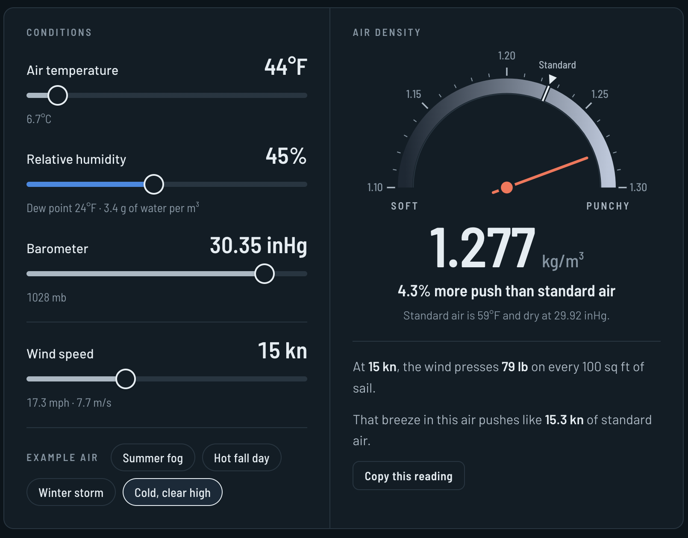

*Supplied cold-air example: 44°F, 45% RH and 30.35 inHg, with density 1.277 kg/m³.*

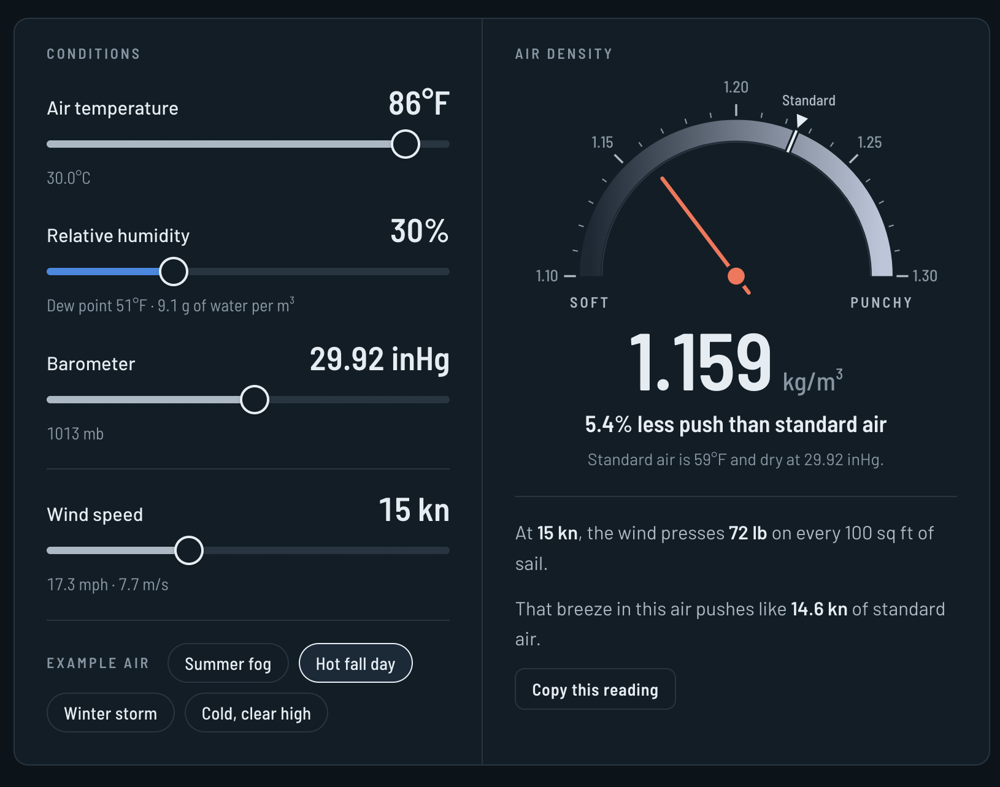

*Supplied warm-air example: 86°F, 30% RH and 29.92 inHg, with density 1.159 kg/m³.*

At 15 kn, these examples show force-equivalent standard-air speeds of approximately **15.3 kn** and **14.6 kn**. Temperature, humidity and pressure all differ, so the comparison does not isolate humidity alone. Hold two of those inputs constant to isolate the third.

### Momentum and force versus wind speed

The momentum panel explains the chain: wind speed sets the volume arriving per second, density sets its mass, and speed also sets momentum per unit mass. The implemented force relation is:

```text
q = 0.5 × density × speed²
F = q × drag coefficient × area
```

The illustrative flat plate uses a coefficient of **1.28**. Doubling speed gives four times the force at fixed density. The “stopping all the arriving momentum” value is a teaching comparison; the actual flat-plate estimate uses the equation above.

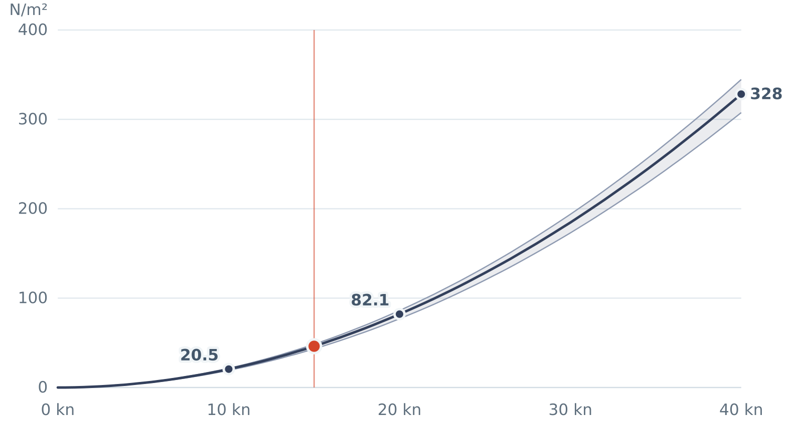

*Extracted flat-plate force-per-area plot, with soft-air, selected-air and punchy-air comparisons.*

Change **Wind speed**, drag or tap the chart, and change sail area to see total load. This is a flat plate facing the wind. It is not a trimmed-sail polar, apparent-wind calculation or a prediction of boat speed.

### Density across temperature and humidity


*Extracted density-versus-temperature plot for multiple relative-humidity levels.*

At a fixed pressure, warmer air is less dense. At a fixed temperature and pressure, water vapor also reduces gas density because it replaces heavier dry-air molecules. The humidity curves spread apart at higher temperatures because the saturation vapor pressure rises strongly with temperature. The current-setting marker and standard-density line are reference aids, not uncertainty bounds.

### Water vapor capacity

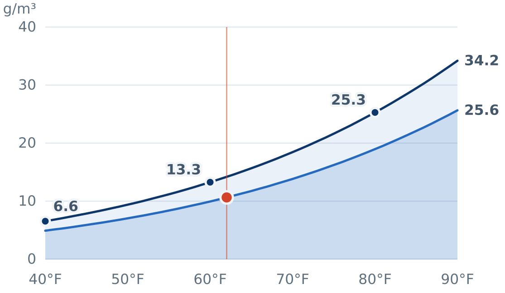

*Extracted water-vapor-versus-temperature plot from Bay Air Density.*

The upper envelope is the saturation vapor concentration. The selected humidity gives the vapor actually present. Relative humidity is a fraction of saturation at the current temperature, so equal RH at two temperatures does not mean equal vapor mass.

### Evaporating fog

The fog panel is a before-and-after table rather than a separate plotted chart. It lets droplets evaporate into the selected air at approximately constant pressure, with no outside heat. Evaporation cools the air and increases humidity until the available liquid is used or saturation prevents further evaporation.

The saved density-tool panel gives the following example. These are source-panel values, distinct from the two supplied gauge screenshots.

| Quantity | Before | After |
| --- | --- | --- |
| Temperature | 62.0°F | 61.3°F |
| Relative humidity | 75% | 78.4% |
| Liquid fog water | 0.20 g/m³ | 0.00 g/m³ |
| Density including droplets | 1.2117 kg/m³ | 1.2130 kg/m³ |
| Flat-plate force per area at 15 kn | 46.18 N/m² | 46.23 N/m² |

The panel reports **492 J/m³** of heat consumed and **36.1 J/m³** of wind kinetic energy. The heat does not turn into additional wind power; it goes into evaporating water. The force change in this example is only about **0.11%**.

The lower density table repeats the same calculations over temperature and humidity. Its cells are useful for exact values; the plots show the trends. The built-in benchmark table checks selected formulas, not complete sailing performance.

## Sea Cliff Lift

This tool adds a cliff, a lifted air parcel and a wing. It estimates forced ridge uplift, modifies it for stability and buoyancy, and subtracts a density-corrected minimum sink.

### Set the inputs in physical order

1. Enter beach temperature, humidity and pressure.
2. Set cliff-top wind, angle off straight in and cliff height.
3. Choose **Slope the airflow follows**, expressed as rise divided by horizontal run. A 1:4 airflow slope is 0.25; it is not a 4-degree or a vertical rock face.
4. Set wing minimum sink at standard-air conditions.
5. Set environmental lapse rate, humidity at cliff-top height and the inversion.
6. Adjust **Sun heating the air**, a sensible heat flux into the air rather than the full incoming sunlight at the ground.

### Cliff-top lift budget

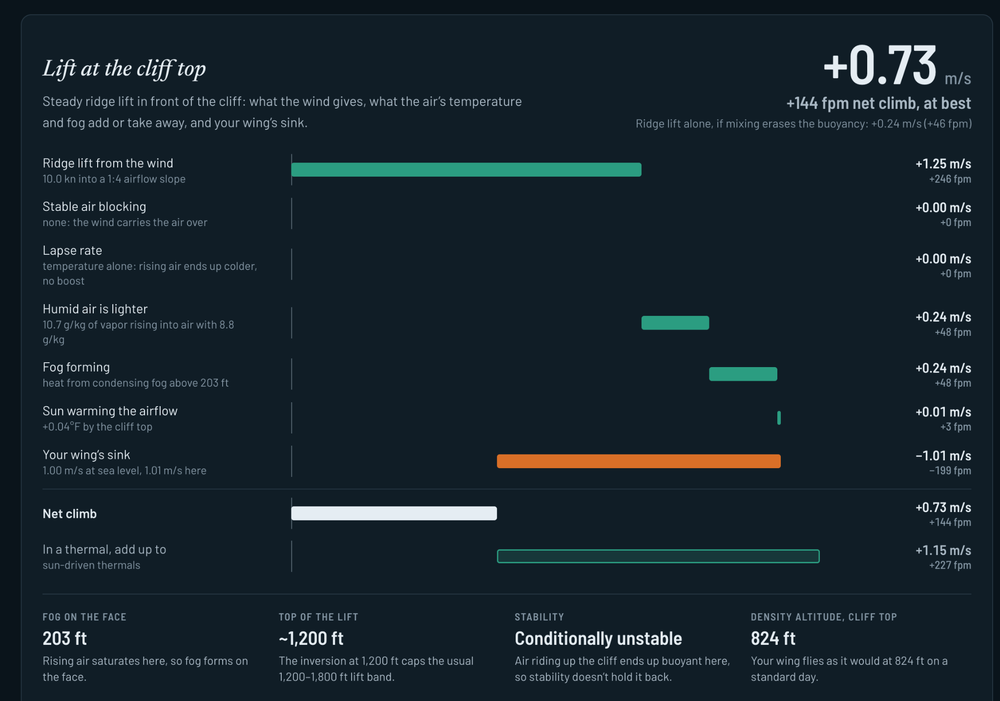

*Supplied lift-budget example: modeled net climb is +0.73 m/s after subtracting wing sink.*

The bars account for wind-driven ridge lift, stable blocking, temperature structure, water vapor, condensation, solar warming and wing sink. A positive net-climb value is the model’s outcome under its assumptions, not a guarantee of usable flight conditions.

Humidity, condensation and heating interact. Their displayed contributions use **Shapley values**, averaging incremental effects over the possible orders in which they are added. The bars add to the total, but they are not independent measured velocities.

### Temperature profiles lapse rates and saturation

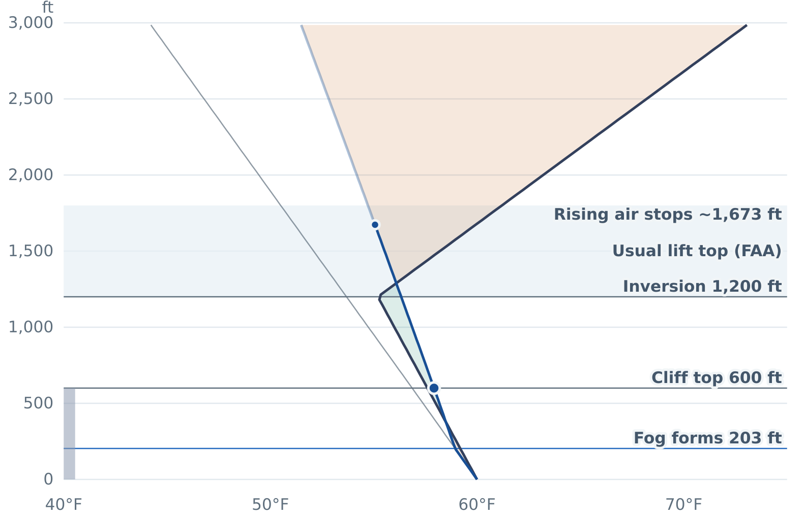

*Extracted parcel and environmental temperature diagram from the saved lift tool, including cliff top, saturation height, inversion and idealized stopping height.*

Read height vertically and temperature horizontally. The dark environmental curve follows the chosen lapse rate and inversion; the blue parcel curve follows the modeled rising air. The dry comparison shows the different cooling rate before condensation changes the parcel’s evolution. The source legend identifies the curves and buoyancy shading.

In this saved plot, fog begins near **203 ft**, the cliff is **600 ft**, the inversion begins at **1,200 ft**, and the ideal parcel stopping height is approximately **1,673 ft**. These labels express different quantities. The screenshot’s “usual lift top” summary should not be treated as the exact parcel stopping height in this separate diagram.

A larger positive environmental lapse rate means faster cooling with height; a negative lapse rate means warming with height. After saturation, latent heat release slows parcel cooling. The model also accounts for water-vapor buoyancy and liquid-droplet loading, so temperature alone does not determine buoyancy.

### Fog forming evaporating and burning off

The tool separately explains condensation on the face, evaporation into drier air and the energy required to remove a fog layer. Its evaporation panel is a before-and-after table, not another chart. Near saturation, only some of the available droplets can evaporate.

The saved lift tool starts its evaporation example at **60°F and 97% RH**. It reports saturation around **59.5°F**, about **0.15 g/m³** evaporated and **368 J/m³** of heat consumed. Its illustrative evaporation-driven sink estimate uses an unmixed parcel over a **100 ft** descent. Do not interpret that estimate as a resolved downdraft.

The sun burn-off time divides an idealized fog evaporation energy by a heat supply. Real burn-off also depends on advection, mixing, radiative transfer and continuing moisture supply. The simplified estimate is an energy scale.

### Density references within the lift tool

These are retained separately because their markers reflect the lift tool’s saved state rather than the density tool’s saved state.

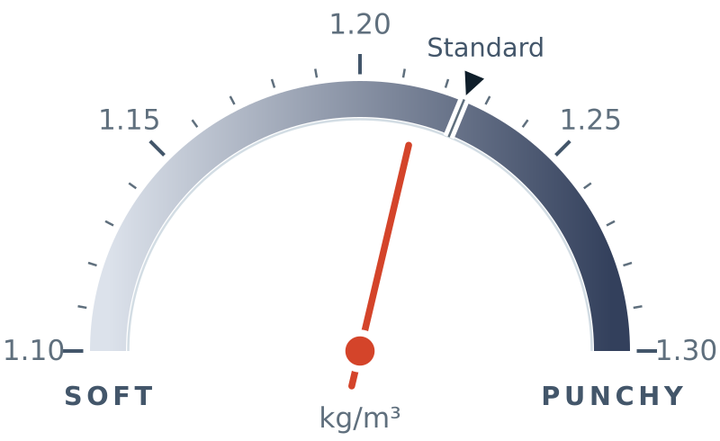

*Extracted density gauge used in the lift tool’s wind-feel section.*

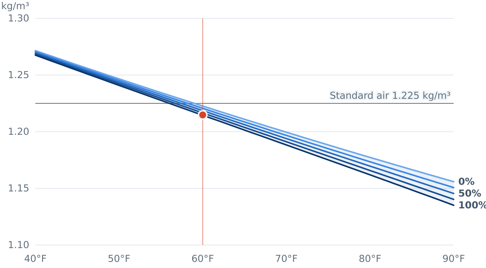

*Extracted density reference plot from Sea Cliff Lift.*

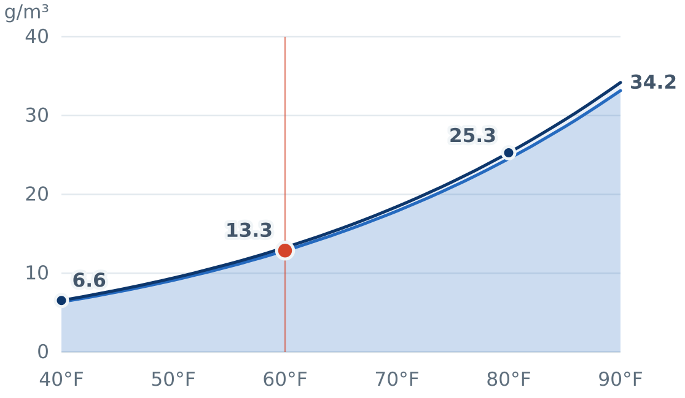

*Extracted water-vapor reference plot from Sea Cliff Lift.*

The tool scales minimum sink approximately as `sink_standard × sqrt(1.225 / density)`. It does not use a complete wing polar, turning performance or pilot control model. The separate thermal estimate characterizes possible sun-driven convection; it is not continuous extra climb available throughout the ridge band.

## Sea Cliff Flow

The two flow files solve evolving wind, turbulence, temperature and water on a vertical grid. They include an along-coast velocity component, but each slice has no resolved along-coast pressure gradient. This is a **2.5D slice model**, not a fully coupled three-dimensional coastal CFD calculation.

### Run inspect and compare

1. Choose **Examples**, or use the initial configuration.
2. Check wind speed and its measurement height, wind direction, marine-layer lapse rate, humidity and inversion.
3. Check sea temperature, surface roughness, sunshine and terrain.
4. Start with **Medium** grid for normal exploration; use Coarse for a fast first look.
5. Press **Run** and watch simulated time, not just wall-clock time.
6. Tap the slice to place the probe, drag to pan and use zoom to frame the cliff.
7. Compare profiles and histories before interpreting a final picture.

Geometry, grid and some configuration changes restart the flow; other changes can modify an evolving simulation. For a controlled comparison, restart both cases and compare similar simulated ages. Animated particles alone do not establish steady behavior.

### Incoming air profile

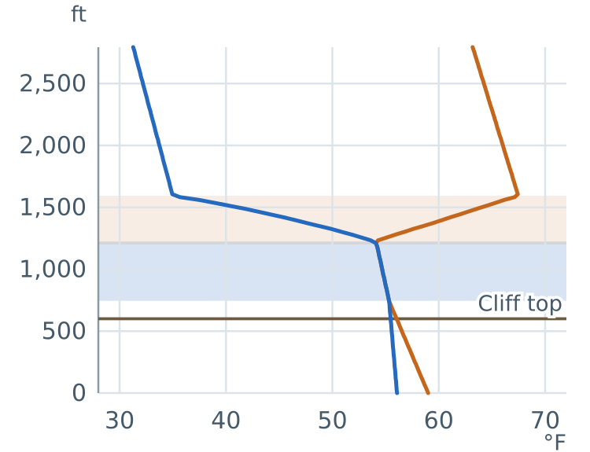

*Incoming temperature and dew-point profile, rendered with the extended tool’s own chart function.*

This profile describes the imposed marine air before terrain modifies it. The temperature–dew-point separation identifies saturation proximity. The inversion and cloud bands describe the prescribed sounding. Check this profile before interpreting cliff-generated fog: fog can already exist in the incoming air.

### Wind and fog context

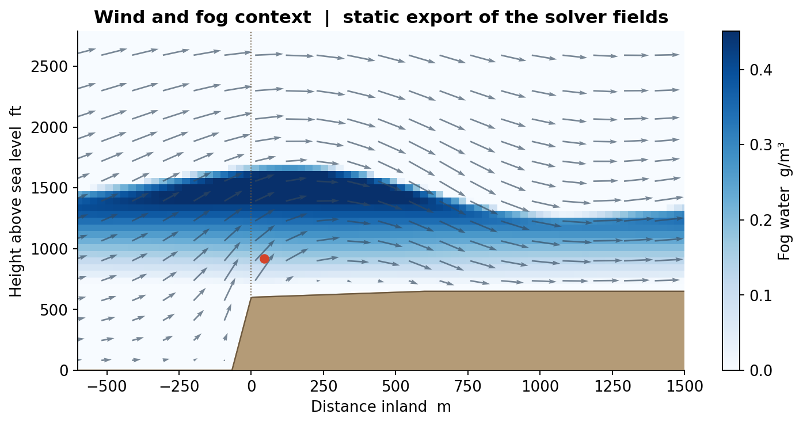

*Static wind-and-fog context from the example solver export; the red point is the profile probe.*

This static export replaces animated particles with velocity arrows. Fog shading comes from liquid-water content. The interactive **Picture** field adds its own sky and fog appearance, particle paths and overlays. Those visual layers communicate structure; they do not add an independent solution.

## Flow field atlas

All field maps below use the same example run near **301 simulated seconds**. They show the quantities implemented by the tool. Static color limits are selected per plot; compare values and color bars rather than comparing colors between different quantities. These exports are not the live canvas’s automatic color limits or exact raster appearance.

### Wind speed

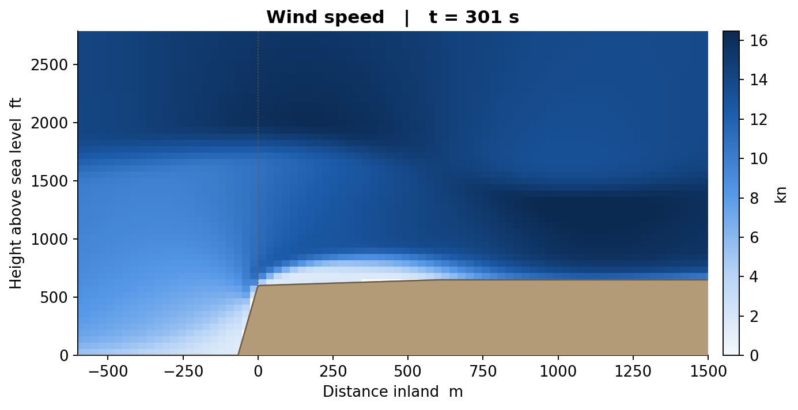

*Wind speed from the example flow solver, in kn.*

Total speed combines cross-shore, vertical and along-coast velocity. It is not just the wind component normal to the cliff.

### Lift and sink

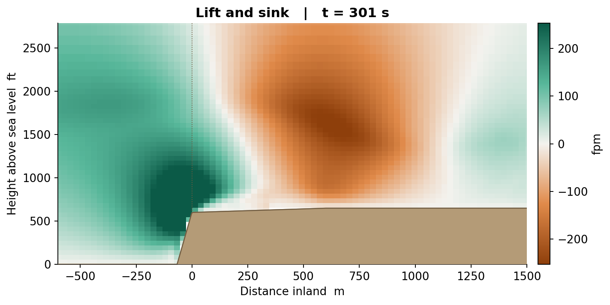

*Lift and sink from the example flow solver, in fpm.*

Positive vertical air velocity is uplift; negative velocity is sink. Compare uplift with the wing’s sink rate to estimate a local climb margin. The interactive lift-band overlay makes this comparison spatially.

### Speed-up

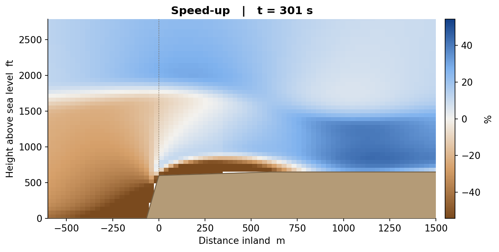

*Speed-up from the example flow solver, in %.*

Percentage speed change relative to incoming wind at the same height above local ground. This differs from a reference at the same absolute altitude.

### Along-coast wind

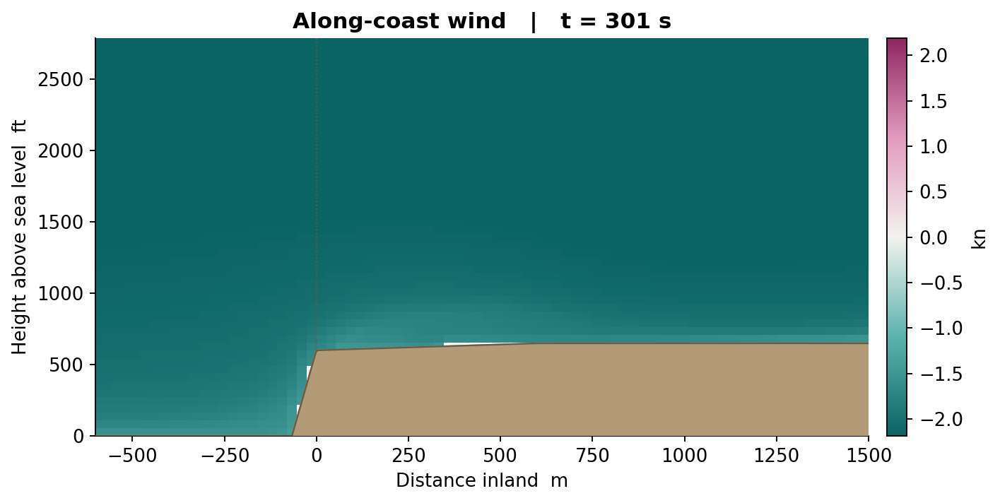

*Along-coast wind from the example flow solver, in kn.*

Velocity parallel to the coast. Its sign depends on the coast orientation. This component is transported in a slice, without a fully resolved along-coast pressure field.

### Temperature

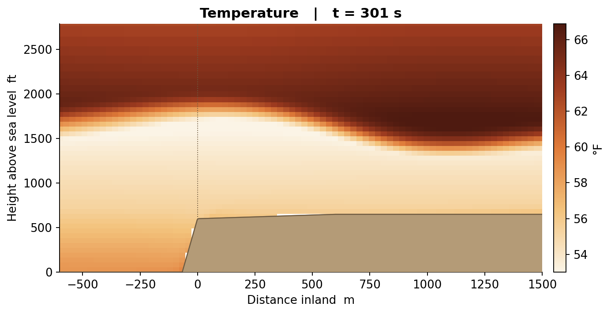

*Temperature from the example flow solver, in °F.*

Absolute modeled air temperature, after advection, phase change and heating.

### Warmer or cooler

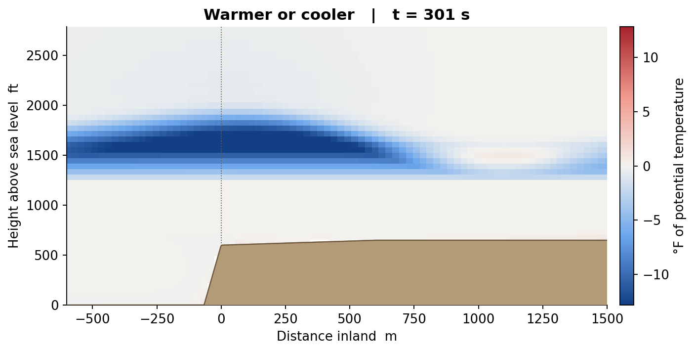

*Warmer or cooler from the example flow solver, in °F of potential temperature.*

The implementation uses potential-temperature departure from the incoming column, converted to a Fahrenheit temperature difference. This is a buoyancy-related anomaly; it should not be read as a second absolute-temperature map.

### Humidity

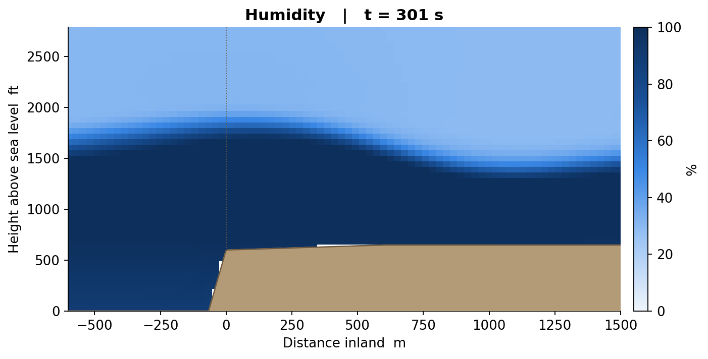

*Humidity from the example flow solver, in %.*

Relative humidity measures vapor saturation. It is distinct from liquid-water concentration, so nearly saturated air and a dense fog layer are not interchangeable.

### Fog water

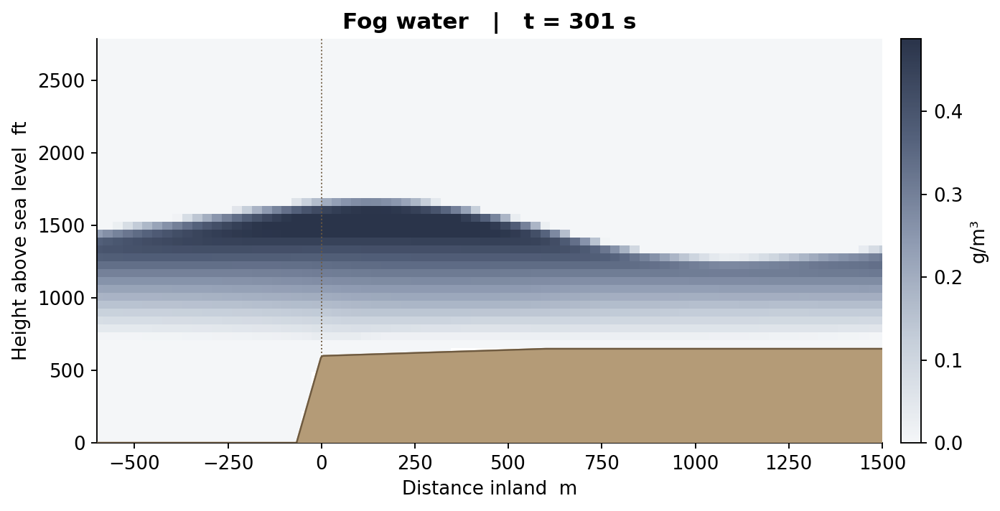

*Fog water from the example flow solver, in g/m³.*

Liquid-water concentration in g/m³. Fog appearance and visibility are parameterized from this water and droplet assumptions.

### Fog forming

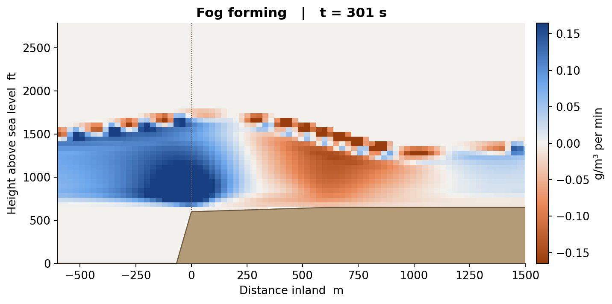

*Fog forming from the example flow solver, in g/m³ per min.*

Positive values mean net condensation and negative values mean evaporation. This is a local rate, not the stock of fog water. As in the display code, a light 1–2–1 spatial smoothing is applied to rate maps.

### Turbulence

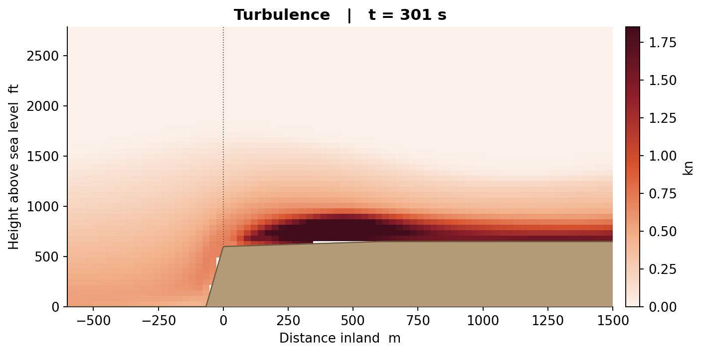

*Turbulence from the example flow solver, in kn.*

The turbulence quantity is sqrt(2k/3), expressed in knots: an estimated velocity standard deviation from the closure. It is not a gust record or a resolved vortex movie.

### Heating  total

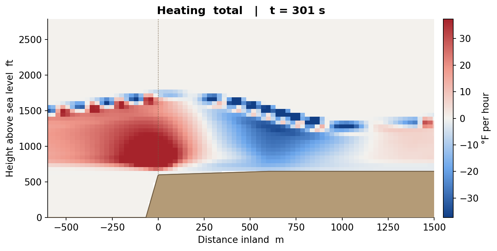

*Heating  total from the example flow solver, in °F per hour.*

Total local heating is the sum of longwave, absorbed solar and phase-change contributions. Units are °F per hour; large local rates do not imply the whole slice warms at that rate.

### Heating  longwave

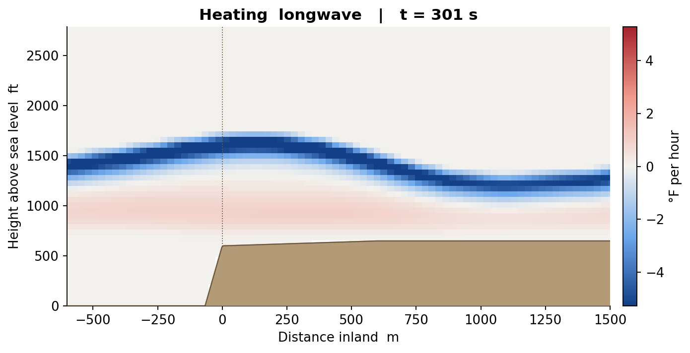

*Heating  longwave from the example flow solver, in °F per hour.*

Longwave radiation typically cools fog near its top and can warm its base. Positive values heat the air; negative values cool it.

### Heating  sunlight

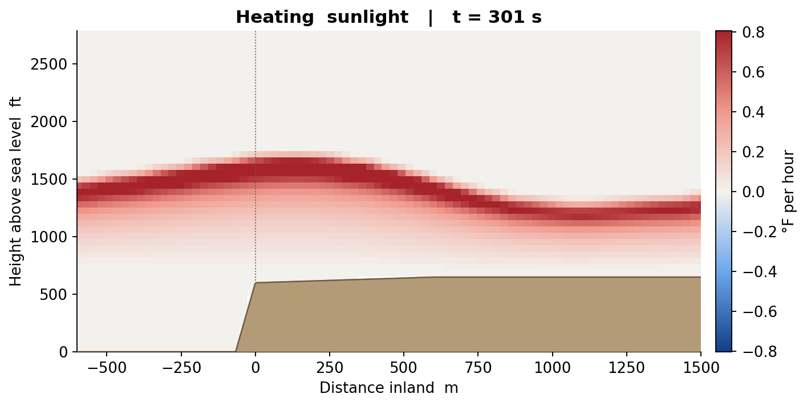

*Heating  sunlight from the example flow solver, in °F per hour.*

Solar absorption heats fog directly. The energy reaching and heating the surface is accounted for separately in surface diagnostics.

### Heating  phase change

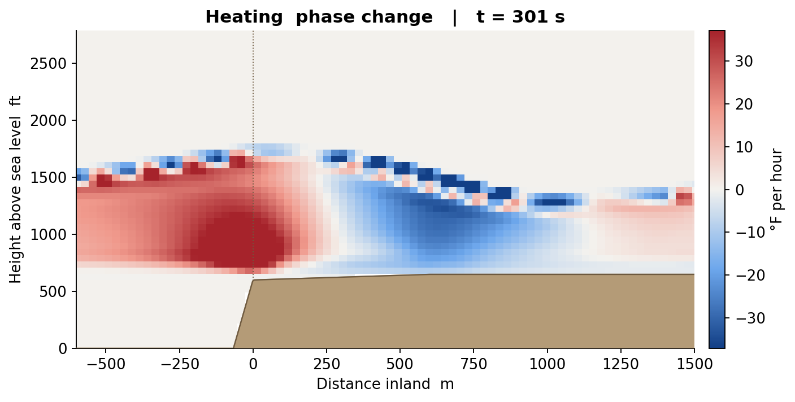

*Heating  phase change from the example flow solver, in °F per hour.*

Condensation releases latent heat and evaporation consumes it. This panel isolates that contribution from direct radiation.

### Overlays and visual interpretation

The interactive tools also provide overlays rather than separate solved fields: particles and air paths, fog edges, isentropes, a lift band, rotor indication and along-coast direction symbols. Green lift-band hatching marks air rising faster than the selected wing sink; orange rotor hatching marks air moving back toward the sea. Isentropes show potential-temperature structure. None of these overlays establishes that the flow is safe to fly.

## Probe profiles and time histories

### Vertical profiles at the probe

The example probe is **45 m inland of the crest** and **280 m above sea level**. Each profile spans height through that horizontal position. The probe line marks the selected sampling height; it does not mean the entire curve is sampled at that one height. The figures below use the tool’s own profile plotting functions.

#### Wind speed

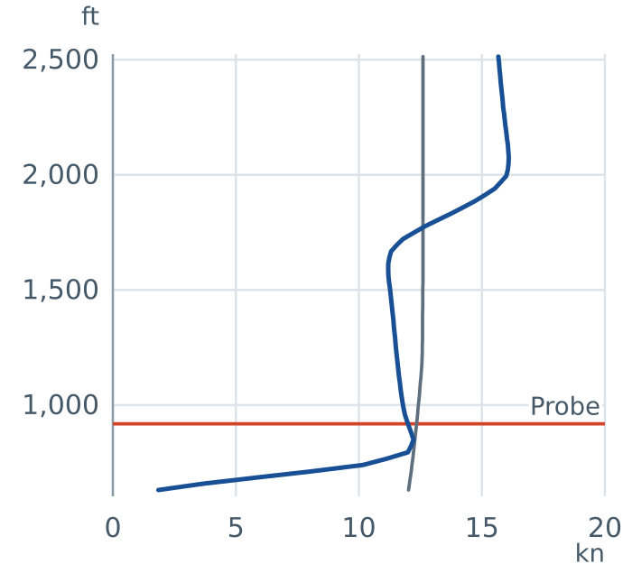

*Source-rendered vertical profile of wind speed.*

Compare local speed with incoming marine wind; a horizontal shift indicates acceleration or slowing at that height.

#### Vertical wind

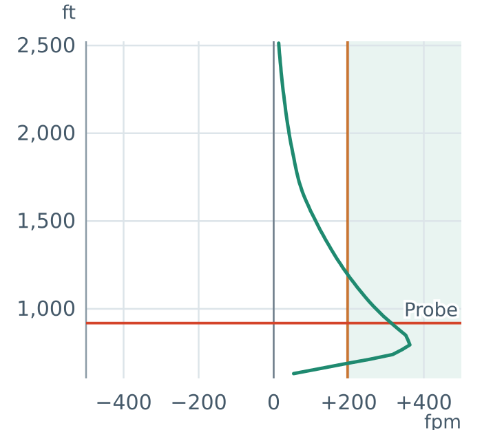

*Source-rendered vertical profile of vertical wind.*

The vertical line for wing sink is a climb threshold. The green band identifies profile values greater than that threshold.

#### Temperature

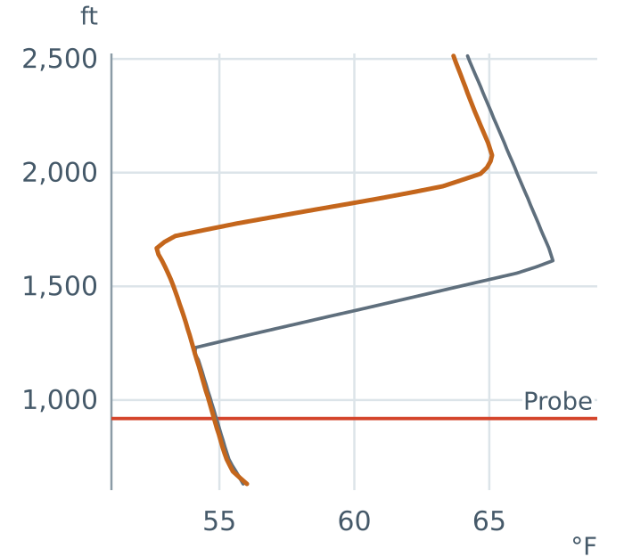

*Source-rendered vertical profile of temperature.*

Compare local and incoming temperatures at the same altitude to identify heating or cooling around the cliff.

#### Humidity and fog

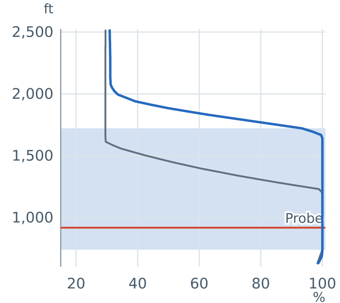

*Source-rendered vertical profile of humidity and fog.*

Compare vapor saturation and the shaded fog layer. The fog band uses the source visibility criterion, not a second humidity axis.

The original in-page legends identify incoming and local curves. In these exported profiles, incoming curves are gray; local wind is blue, local vertical wind green, local temperature orange and local humidity blue. The fog band is translucent blue.

### Histories through simulated time

Histories help distinguish a transient from a result that has stopped drifting. These exports sample the run approximately every **30 simulated seconds**, more sparsely than the normal interactive history.

#### Fog water in the slice

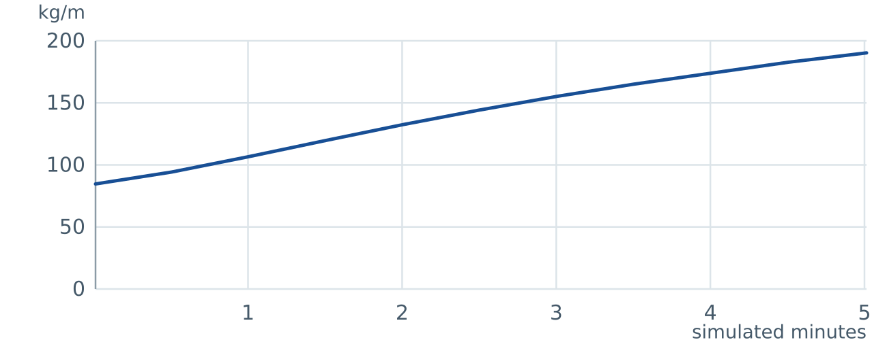

*Source-rendered time history of fog water in the slice.*

This is total fog mass per metre of along-coast width, in kg/m. It is neither g/m³ nor the fog mass over an entire real coastline.

#### Vertical wind at the probe

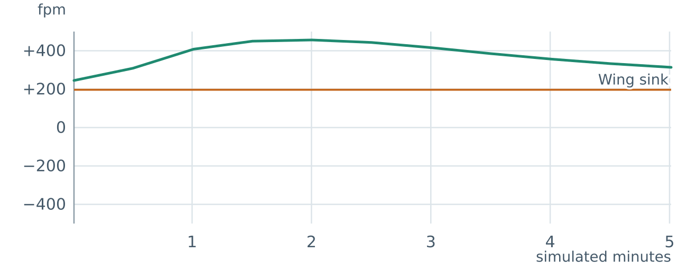

*Source-rendered time history of vertical wind at the probe.*

Track the same fixed probe position through time. Compare with the wing-sink reference line rather than assuming positive vertical wind is positive net climb.

#### Sunshine on the land

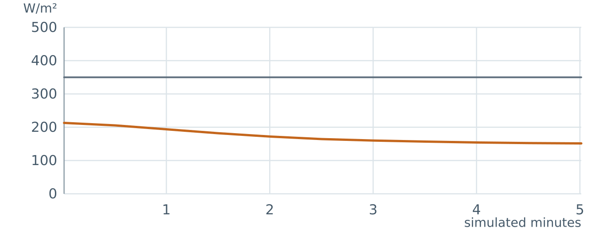

*Source-rendered time history of sunshine on the land.*

Compare the clear-sky input with sunlight reaching the land beneath fog. Incoming clear-sky sunshine can be constant while transmission changes.

## Energy water and turbulence budgets

The interactive budget averages over the **last simulated minute** and normalizes by modeled ground length outside the held-inflow strip. The exports below show **instantaneous solver budgets at the final sample**, with the same normalization and terms. They illustrate the diagnostic structure and are not presented as screenshots of the rolling-average panel.

### Energy into the air

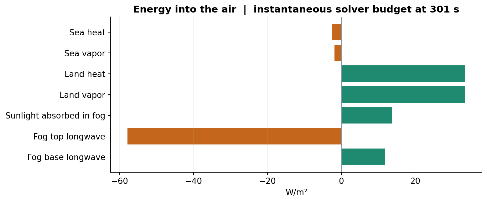

*Instantaneous exported heat and vapor-energy budget, normalized to W/m² of modeled ground.*

Read positive terms as energy entering the modeled air and negative terms as losses. Sea and land vapor terms express transported water as latent energy. Condensation and evaporation exchange sensible and latent energy internally; they are not additional external sources to add again to this external-input budget. The sum need not be zero: the domain can store energy or carry it away with the flow.

### Fog water

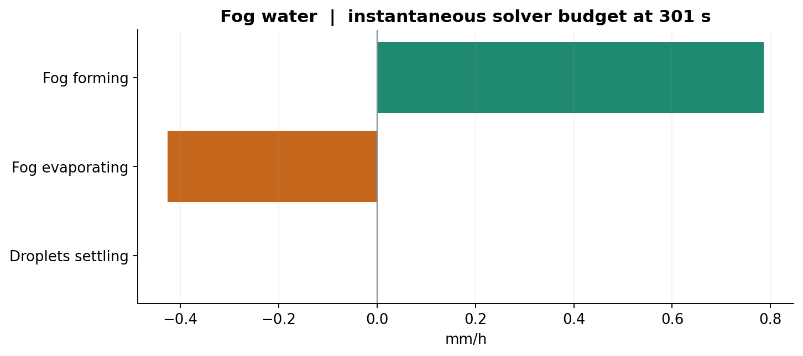

*Instantaneous exported fog-water formation, evaporation and settling terms in mm/h.*

Formation adds liquid water, evaporation removes it and settling deposits it. The net production is not necessarily the change of total stored fog, because advection can transport fog through the slice. This example has no settling contribution at the sampled instant; a zero term is retained rather than omitted.

### Turbulence energy

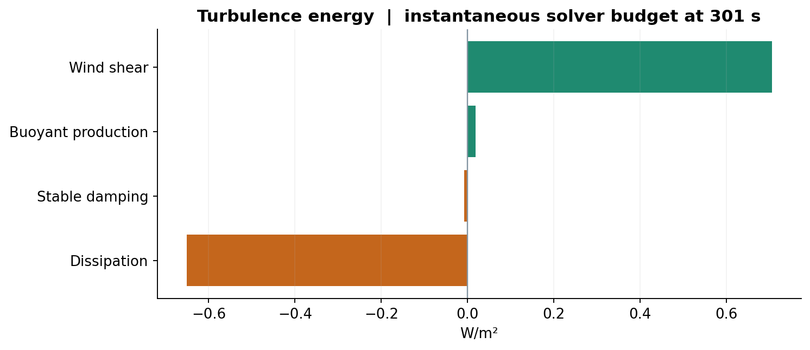

*Instantaneous exported turbulence-production and loss terms in W/m².*

Wind shear and buoyancy can produce turbulence, stable stratification can damp it, and dissipation converts turbulent motion to heat. These are closure-budget terms. They do not resolve individual gusts or thermal cores.

## Extended fog and sunshine views

The extended file adds two major diagrams and changes parts of the physical implementation. The diagrams below belong to **Sea-Cliff-Fl_extend.html**, not the base file.

### Fog through time seen from above

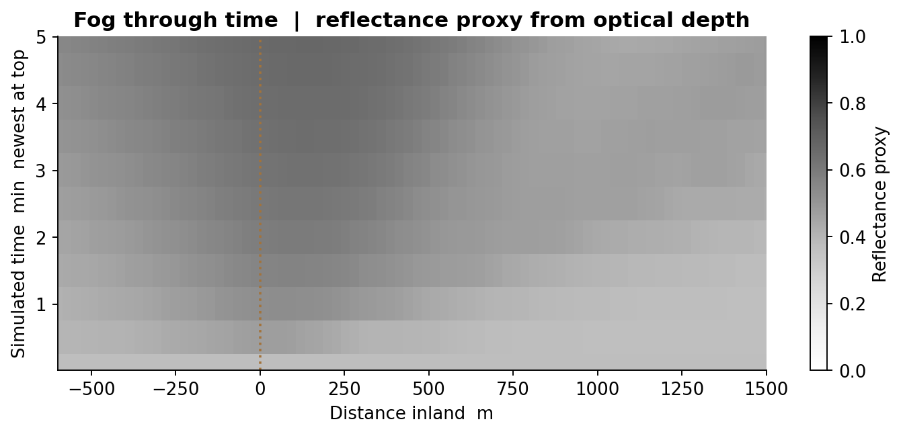

*Static export of the extended distance–time fog map; hatching indicates ground-reaching fog and newest times are at the top.*

The horizontal axis follows distance along the cross-shore slice. The vertical axis is time, not height or along-coast distance. The source display uses optical depth τ to produce a whitened fog proxy: `(τ / (τ + 13))^0.6` above its thin-fog cutoff. Ground fog is identified from liquid water in the lowest fluid cell, using the source threshold **0.0166 g/m³**.

This export uses the same optical-depth proxy and ground-fog criterion with a static grayscale rendering and absolute simulated-minute labels. The live tool blends fog with sea and land colors and labels elapsed time relative to the newest sample. It is a simulated satellite-like view, not an actual satellite product or a measured reflectance retrieval.

### Where the sunshine on the land goes

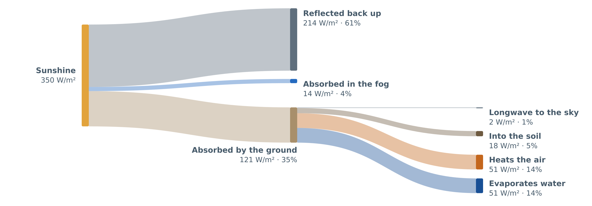

*Solar-energy pathway diagram generated with the extended tool’s actual SVG drawing code and the final example surface state.*

Follow the incoming sunshine into reflection, absorption in fog and absorption by the ground. Then follow the ground’s share into longwave loss, soil heat, sensible heating of the air and evaporation. Band width represents energy flux; percentages refer to the incoming sunshine, so ground-branch percentages should not be mistaken for percentages of the ground share alone.

For this example, incoming sunshine is **350 W/m²**. The source-rendered figure rounds each pathway separately, so displayed integer values may differ by a watt or a percentage point when summed. It averages a specified stretch of land behind the crest **at that instant**, whereas the main budget uses a last-minute domain average. Those diagrams have different averaging areas and times and should not be directly equated.

At night the same panel switches to longwave energy loss supplied by the air and soil. On narrow displays it stacks the daylight pathway stages vertically. Those are alternate layouts or branches of the same diagnostic, not additional independently solved fields.

### Physics differences from the base flow file

The extension revises the no-inversion sounding treatment and sounding saturation handling, and adds a sea vapor-flux configuration option. It also revises presentation and diagnostics. Preserve the exact HTML version for a comparison: identical JSON inputs can yield different results between the base and extended files.

## Terrain and multiple coastal slices

### Along the coast

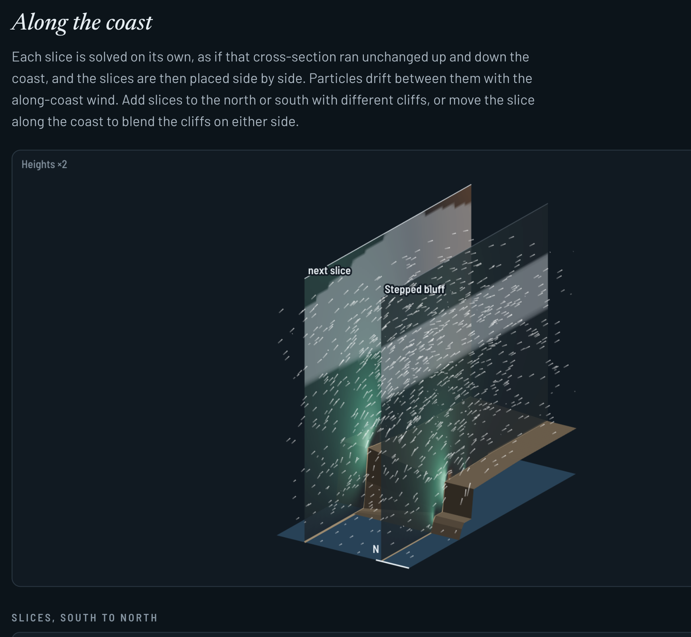

*Supplied coastal-slice view: separate solutions arranged along the coast, with displayed height exaggerated by a factor of two.*

Each slice assumes its cross-section continues along the coast. The three-dimensional view places slices next to one another and lets particles drift through their displayed fields. It does not solve pressure or terrain-induced lateral exchange across a continuous three-dimensional domain.

Use **Add a slice here**, **Copy to the north**, **Remove slice** and **Solve every slice** to build a set of geometries. Moving to an intermediate position can blend the geometries on either side. Compare solved slices at similar simulated ages. **Coast length** controls parameterized drainage of blocked marine air; actual flow around a headland or through a gap is not explicitly modeled.

### Import real terrain

Choose **Load a terrain profile**, or drop a supported file onto the page. GPX, KML and GeoJSON lines must include elevations. CSV supports distance/elevation pairs or latitude/longitude/elevation records. A geographic line without heights cannot provide a terrain section.

Draw the line from the water inland across the cliff. Check the import preview, sea endpoint, elevation units and coast-facing direction before accepting it. Automatic inference takes the lower endpoint as the sea unless you override it; that assumption can fail for complex terrain. Verify the inferred shoreline and crest.

The manual point editor displays distances and elevations in **feet**. Saved JSON uses **SI units**, including metre-based terrain point pairs. Do not paste metre values into the foot-based editor or silently reinterpret saved JSON as display units.

## Save reproduce and troubleshoot

### Configuration files

**Open .json** loads a flow setup. **Copy JSON** exposes or copies its text; **Save .json**, image export and **Download the tool (.html)** appear where the environment supports them. If a download or clipboard action is unavailable, manually select the configuration text and save it as a JSON file.

The flow schema identifies `format: "sea-cliff-flow"` and `version: 1`. It contains site, wind, air, surfaces, sunshine, fog, pilot sink, domain and slice settings. JSON saves a **configuration**, not a checkpoint of the evolved velocity, heat and fog fields. Reopen the matching HTML and rerun the case.

The density and simplified lift tools do not load this flow schema. Transfer comparable inputs manually, taking care that the simplified tool’s wind is at cliff-top height while the flow tool specifies a measurement height over open water.

### Reproducible study record

Keep the exact HTML, configuration JSON, grid, simulated age, probe position and exported pictures together. Record whether a diagram uses an instantaneous state or a time average. A numerical result without its model version and sampling location is difficult to compare meaningfully.

The included figure run uses the default extended-file conditions: a nominal **182.9 m cliff**, **6.17 m/s wind at 182.9 m**, **15°C sea-level air**, **90% sea-level RH**, and an inversion beginning near **365.8 m**. See the JSON for all settings; the only intentional change from defaults is Coarse resolution.

### Troubleshooting

| Symptom | First checks |
| --- | --- |
| A preview is blank or the flow does not start | Open the saved HTML in a modern browser; workers may be restricted in previews. |
| Flow is slow | Use Coarse or Medium, solve fewer slices and close other CPU-heavy tabs. |
| Terrain is inverted or implausible | Check sea end, elevation units, heights and the import preview. |
| Lift seems implausibly large | Check wind reference height, airflow slope, lapse-rate units, inversion and grid sensitivity. |
| Run changes after reloading JSON | JSON restarts the setup; it does not restore evolved fields. Also confirm the HTML version. |
| Clipboard or save button fails | Manually select and save the JSON text. |
| README images do not render after upload | Upload the complete folder structure; keep relative `images/` links intact. |

For a repository, upload **README.md plus the images folder**, not the Markdown file alone. The ZIP preserves that structure and also includes the tools and example configuration. PNG files are used in the README for broad compatibility; original/extracted SVG files are retained alongside them where available.

## Physics checks and limits

### What is implemented

| Tool | Core approach | Key limits |
| --- | --- | --- |
| Bay Air Density | Ideal-gas dry-air/vapor mixture, saturation pressure, flat-plate force and an evaporation enthalpy balance | No gust model, sail trim or boat-performance model. |
| Sea Cliff Lift | Prescribed airflow slope, bulk stability/blocking, unmixed lifted parcel, heating and density-corrected sink | No entrainment-resolving calculation, rotor field, wind shear profile or full wing polar. |
| Both flow tools | Cartesian finite volumes, Boussinesq flow, pressure projection, k–ε turbulence, moist thermodynamics and surface/radiative exchange | Slice assumptions, averaged turbulence, cell-blocked terrain and simplified boundaries. |

The density implementation uses `ρ = (p − e)/(Rd T) + e/(Rv T)`. In the simplified lift calculator, normal wind is `U cos(angle)` and the forced vertical component for airflow rise/run `s` is `U_normal × s / sqrt(1 + s²)`. Positive integrated parcel buoyancy can increase the idealized lift estimate; negative buoyancy limits the rise above the crest.

The flow solver carries liquid-water potential temperature and total water, applies saturation adjustment, and includes vapor buoyancy and liquid loading. It parameterizes turbulence and individual thermals rather than resolving each eddy or core. Radiation includes fog longwave effects and banded solar transfer. Broad weather systems, Earth’s rotation, drizzle, salt and haze and fully coupled three-dimensional terrain flow are outside its scope.

### Use the benchmark sections correctly

The tools contain method notes, reference links and benchmark tables. In the flow tools, thermodynamic and optical checks are calculated live, while some flow-check values initially come from stored build-time runs. **Run the flow checks again** reruns the relevant tests. Formula agreement is not an error bound for your chosen cliff.

Compare Medium and Fine at the same physical positions and similar simulated ages. The tool’s notes identify stronger grid sensitivity close to the ground. Check whether probe and water/energy histories still drift. A five-minute illustrative Coarse run, including this guide’s example, is not a convergence study.

Use these tools to understand mechanisms and compare assumptions. Their output is not a site forecast or flight clearance. The supplied and newly rendered pictures demonstrate model behavior rather than measured coastal conditions.

### References in the tools

The HTML files contain the full linked references for their calculations. Major references include:

- [CIPM-2007 moist-air density](https://www.nist.gov/sites/default/files/documents/calibrations/CIPM-2007.pdf).
- [NIST water properties](https://webbook.nist.gov/chemistry/fluid/) and the IAPWS saturation-pressure formulation cited in each tool.
- [NASA Glenn density effects](https://www1.grc.nasa.gov/beginners-guide-to-aeronautics/density-effects/) for aerodynamic scaling.
- FAA ridge-soaring and weather guidance, linked in the lift tool.
- [Cavar and colleagues on neutral flow over complex terrain](https://wes.copernicus.org/articles/1/55/2016/), plus the flow tool’s Bolund references.
- The flow tool’s DYCOMS-II, Slingo droplet optics, delta-Eddington transfer, settling and fog-extinction references.

These links are reproduced from the source files; this README does not claim a new literature review or independent validation.

## Figure coverage and provenance

| Tool area | Included illustrations | Origin |
| --- | --- | --- |
| Density console | Gauge and two contrasting air examples | Original SVG and supplied screenshots |
| Wind loading | Force-versus-speed plot | Original SVG |
| Density and vapor | Both plots from each calculator | Original SVGs, retaining the different saved states |
| Lift | Budget and lapse-rate/parcel diagram | Supplied screenshot and original SVG |
| Flow inputs | Incoming sounding | Tool’s own SVG chart code |
| Flow context | Wind and fog | Solver data rendered statically |
| Flow field selector | Every numerical field, including all four Heating views | Solver data with source quantity definitions |
| Probe | All four vertical profiles | Tool’s own SVG chart code |
| Time histories | Fog mass, vertical wind and sunshine | Tool’s own SVG chart code |
| Budgets | Energy, liquid water and turbulence | Instantaneous solver terms rendered statically |
| Extended views | Fog distance–time map and solar-energy pathways | Source proxy rendered statically and original SVG drawing code |
| Along the coast | Multiple-slice view | Supplied screenshot |

Text-only panels, input controls, numerical tables and alternate responsive layouts are explained in the guide; they are not all duplicated as screenshots. The base flow file shares the principal diagnostic types with the extension, so the shared atlas uses one documented extended-file run instead of presenting identical-looking figures twice.

The HTML source files are included unchanged. Original SVG geometry is preserved for extracted charts with resolved light-theme colors and local font substitutions. Source-rendered SVG charts retain the tool’s drawing logic, with exported run data and static styling. Canvas field exports use the source quantities and palettes but a separate static renderer. Their appearance should not be confused with a browser screenshot.
